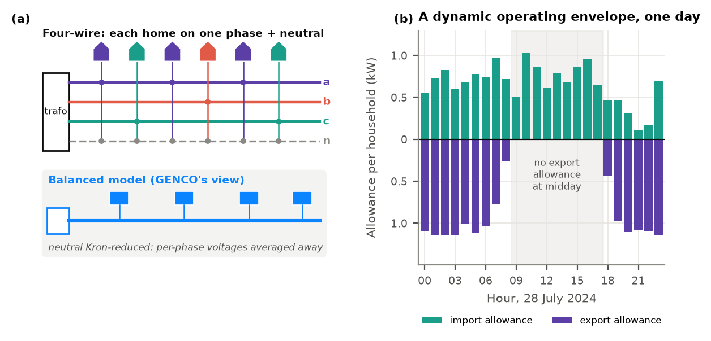
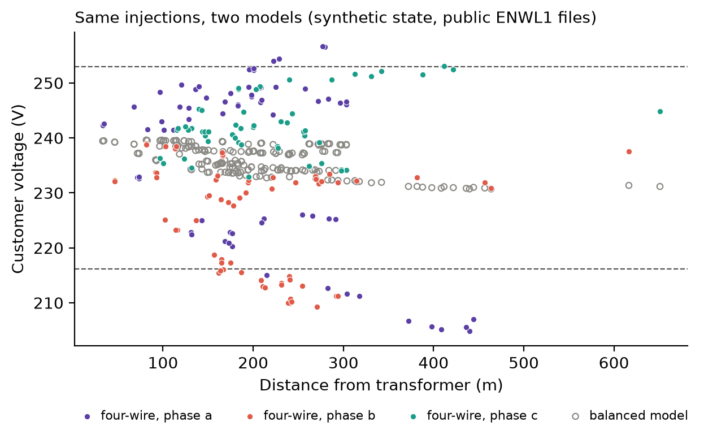

# GENCO meets the neutral wire: four-wire dynamic operating envelopes for low-voltage grids

Taking the GENCO grid foundation model to three-phase four-wire low-voltage distribution networks: what breaks, and how a phase-aware GENCO repairs it. An entry for the [GridFM GENCO Challenge 2026](https://huggingface.co/spaces/gridfm/genco-challenge).

**Ander Martinez Alonso¹,³, Evgenii Genov¹, Rémy Cleenwerck¹,²**
¹ EVERGi, Vrije Universiteit Brussel · ² EnSy/Lemcko, Ghent University · ³ DTU Wind and Energy Systems, Technical University of Denmark
Contact: ander.martinez.alonso@vub.be



## Start here

| If you want… | Go to |
|---|---|
| **The submission** | [`docs/hf_post.md`](docs/hf_post.md) (the Hugging Face post; [PDF](docs/hf_post.pdf)) |
| A one-minute demo, no data access needed | `python scripts/demo_neutral_wire.py` (below) |
| What we claim and do not claim | [`docs/claims.md`](docs/claims.md) |
| Every experiment, result and incident | [`docs/experiment_log.md`](docs/experiment_log.md) |
| Protocols and pre-registration | [`docs/preregistration.md`](docs/preregistration.md) and the `docs/*_protocol.md` files |
| The official-checkpoint experiments (case118) | commit [`994d5d4`](https://github.com/ujohn33/genco-dynamic-envelopes/tree/994d5d416a0c45fdbf6045c7103f3cd9c7519b53) on branch `ander-case118` |
| One-page summary | [`docs/genco_challenge_onepager.pdf`](docs/genco_challenge_onepager.pdf) |

## In brief

Dynamic operating envelopes give each household a time-varying import and export allowance instead of a fixed connection limit. On European low-voltage networks every home sits on one phase and the neutral carries the imbalance, so envelopes depend on three-phase four-wire physics. GENCO represents the grid as balanced.

- **On this feeder, a balanced model is not a usable proxy.** Across every hour of 36 evaluation days, no positive balanced-model envelope met the four-wire feasibility target (0 of 864 export, 0 of 823 import hours).
- **A phase-aware GENCO makes learned screening useful.** As a pre-screen it cuts full four-wire OpenDSS simulations six-fold (fallbacks 35.8% → 5.8%), with zero observed false-safe decisions on 2,968 evaluation states. Balanced screens, GENCO included, fall back on 63%.
- **Dynamic envelopes release real headroom:** 4.81 MWh of export and 2.50 MWh of import envelope-hours per household per year, where a fixed allowance valid in every hour would be zero.
- **The official pretrained GENCO helps where the representation matches.** On case118, fine-tuning beat training from scratch by +11.4 points [9.8, 12.5] in 5 of 5 seeds at 100 labels.
- **Physics stays in charge.** An iterated four-wire sweep remains the most accurate method. Every issued envelope passes a directional four-wire OpenDSS test on its 200 design scenarios (export: overvoltage and loading; import: undervoltage and loading; full simultaneous uptake). It is a design-set test, not a certificate: opposite-side voltage, neutral current and partial uptake are not checked.

## Quick demo (public data only)

```bash
uv sync --all-extras --no-install-package torch-scatter
uv run python scripts/demo_neutral_wire.py
```

It solves one deliberately stressed synthetic household state on the public ENWL1 feeder files, with the balanced model and with four-wire OpenDSS, in a few seconds:

```
balanced model : 230.7-239.6 V, customers outside 216.2-253.0 V: 0
four-wire      : 204.8-256.6 V, customers outside 216.2-253.0 V: 34
transformer LV neutral current: 401 A
```



## Reproducing

With [uv](https://docs.astral.sh/uv/) (`uv.lock` pins every package, `.python-version` pins Python 3.12):

```bash
uv sync --all-extras --no-install-package torch-scatter   # everything except torch-scatter
uv sync --all-extras                                      # torch-scatter, built against the installed torch
uv run pytest                                             # 84 tests; on a fresh clone 74 run, 10 skip (need data)
GENCODOE_VOLTAGE_LIMITS=uk_esqcr uv run python scripts/reproduce_check.py
```

- The two `uv sync` steps are needed because torch-scatter imports torch in its build script (see `[tool.uv]` in `pyproject.toml`). The first `import juliacall` (OPF modules, gridfm-datakit) downloads Julia and the pinned PowerModels/Ipopt packages into `.venv/julia_env`, once.
- `reproduce_check.py` deterministically regenerates the aggregate reports from locally retained run artifacts (`data_out/`) and verifies the A100 four-wire evaluation against its recorded SHA-256. It does not cover the case118 studies, which have their own manifests on branch `ander-case118`.
- **Public inputs.** The ENWL1 feeder files are in `data/feeder_topology/ENWL1/`, and the household profiles are the public Fluvius open dataset (see below). Download it so the CSVs sit one level below `data/load_profiles/`, i.e. `data/load_profiles/<folder>/P6269_Open_Data_<group>.csv`.
- **What a fresh clone cannot do yet.** The derived run files and LV checkpoints (`data_out/`, about 7 GB) are not yet redistributed while we check the licence terms for meter-level derivatives, so a fresh clone cannot reproduce every headline result end to end. Their SHA-256 hashes are in `results/run_manifest_*.json`.
- **Environment.** `env-snapshot-laptop.txt` (macOS) and `env-snapshot-hydra.txt` (Linux A100 cluster) record the exact package versions used. They are snapshots, not installable locks.

## Repository layout

| Path | Contents |
|---|---|
| `src/gencodoe/enwl.py`, `unbalanced.py` | ENWL1 balanced reduction; four-wire OpenDSS model |
| `src/gencodoe/doe_day.py`, `envelopes.py` | Envelope search and the finite-sample acceptance rule |
| `src/gencodoe/genco*.py`, `four_wire.py`, `cplus.py` | GENCO LV variant, four-wire screen, final check |
| `src/gencodoe/fourwire_*.py` | Four-wire network, sweep, labels, phase-aware GNN, frozen evaluation |
| `src/gencodoe/envpred3.py` | Learned envelope proposals with one final check |
| `src/gencodoe/report_*.py` | Report generators (the only source of reported numbers) |
| `scripts/` | Figures (`make_figures.py`, `paper_figures.py`), demo, `reproduce_check.py`, Hydra job scripts |
| `results/` | Committed result files and run manifests |
| `figures/` | All figures used in the post |
| `docs/` | The post, claims, experiment log, pre-registration, reporting plan, work plan, protocols and amendments, one-page summary |
| `data/feeder_topology/ENWL1/` | Public ENWL1 feeder files: four-wire line codes, neutral earthed only at the transformer (TT) |

## Data and sources

- **Feeder:** ENWL1 from Electricity North West's Low Voltage Network Solutions project: https://www.enwl.co.uk/future-energy/innovation/smaller-projects/low-carbon-networks-fund/low-voltage-network-solutions/
- **Household profiles:** Fluvius Open Data, *Verbruiksprofielen digitale elektriciteitsmeters: kwartierwaarden voor een volledig jaar* (2,400 anonymised residential meters, quarter-hourly, 2024, eight technology groups): https://opendata.fluvius.be/explore/assets/1_50-verbruiksprofielen-dm-elek-kwartierwaarden-voor-een-volledig-jaar/
- **GENCO:** arXiv:2608.09921 (https://arxiv.org/abs/2608.09921); tooling https://github.com/gridfm/gridfm-graphkit and https://github.com/gridfm/gridfm-datakit; official checkpoint https://huggingface.co/gridfm/genco-opf-datakit
- **Challenge:** https://huggingface.co/spaces/gridfm/genco-challenge
- **Solvers:** OpenDSS (EPRI, https://www.epri.com/pages/sa/opendss), PowerModels.jl with Ipopt (case118 studies).
- The full reference list is at the end of [`docs/hf_post.md`](docs/hf_post.md).

## Status of the evidence

- **Pre-registered:** the full OpenDSS envelope search and the GENCO screen.
- **Frozen before their results were seen:** everything else (sensitivities, spatial envelopes, envelope proposals, the four-wire extension, the case118 studies). These are exploratory, and the evaluation days were also used in development.
- **Disclosed, not hidden:** every protocol deviation and every incident, including a wrong voltage base, an OpenDSS engine-poisoning bug, stale cluster caches, an invalid fit and an invalid evaluation. See the amendments and the experiment log.

## Citation

See [`CITATION.cff`](CITATION.cff).

## License

The project code is Apache-2.0, matching the OpenGridFM toolkits. Third-party data in this repository (ENWL1 feeder files, the Fluvius legend workbook) keep their own terms; see [`DATA_LICENSES.md`](DATA_LICENSES.md).
