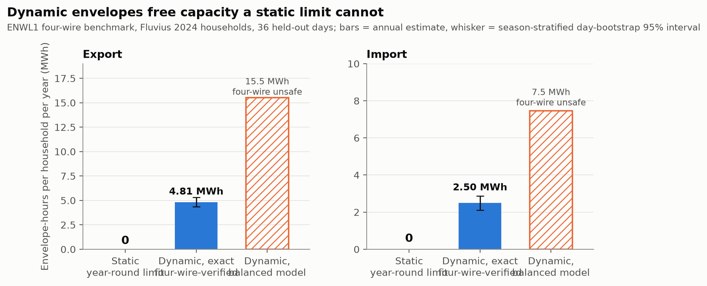

# Four-wire-verified dynamic operating envelopes: where GENCO helps, and where it does not

An entry for the [GridFM GENCO Challenge](https://huggingface.co/spaces/gridfm/genco-challenge) (deadline 25 October 2026, AoE).

## Start here

| If you want… | Read |
|---|---|
| The story in five minutes | [`docs/hf_post.md`](docs/hf_post.md) (Hugging Face post), [`docs/genco_challenge_onepager.pdf`](docs/genco_challenge_onepager.pdf) |
| What was done, where it is, what is open | [`docs/HANDOFF.md`](docs/HANDOFF.md) |
| What we claim and do not claim | [`docs/claims.md`](docs/claims.md) |
| Every experiment, result and incident | [`docs/experiment_log.md`](docs/experiment_log.md) |
| The figures | [`figures/`](figures/) (made by `scripts/make_figures.py`) |



## In one paragraph

A **dynamic operating envelope** (DOE) is a time-varying import/export limit per household that a distribution operator can issue instead of a fixed connection limit.
- **What we computed:** DOEs on the four-wire **ENWL1** low-voltage benchmark feeder (UK, 800 kVA, 200 single-phase customers), populated with real **Fluvius 2024** smart-meter profiles. Every envelope issued by the exact search and its gated variants is checked against an exact four-wire OpenDSS model under a frozen finite-sample acceptance rule.
- **The DOE result:** dynamic envelopes free several MWh of optional import/export capacity per household per year where a constant optional add-on above the passive demand frees none. A balanced (three-phase-averaged) model would issue envelopes that are badly unsafe on the four-wire benchmark feeder.
- **What we did with GENCO:**
  - adapted it to LV networks, where the stock model fails;
  - put it inside the verified envelope workflow;
  - extended a GENCO-style model to an explicit four-wire (phase + neutral) representation;
  - benchmarked every GENCO role against strong classical baselines.
- **The honest bottom line:** GENCO-style learning helps when it corrects a cheap four-wire physics prior. Frozen embeddings from our feeder-specific balanced GENCO add no value on this problem, and specialised classical four-wire physics remains the accuracy leader.

## Headline results

All numbers regenerate from committed results (`scripts/reproduce_check.py`). Wording follows [`docs/claims.md`](docs/claims.md).

| What | Result |
|---|---|
| Optional capacity, exact four-wire-verified DOEs (36 test-split days, hourly) | **4.81 MWh export** (4.35–5.30) and **2.50 MWh import** (2.11–2.87) envelope-hours per household per year. A constant optional add-on: **0** |
| Balanced-model envelopes | about 2–3× larger, and four-wire feasible in only 2% (export) / 24% (import) of draws on a summer day |
| Robustness to which households own HP/EV/PV (5 placements) | export 4.81–6.18, import 2.50–3.22 MWh. The headline placement is the most conservative |
| Idealised three-phase connection of HP/EV homes (two placements) | capacity about 2–2.5× higher: single-phase connection is a major contributor to congestion |
| Spatial (feeder × phase) envelopes | import 2.14×, export +11%, at lower out-of-sample robustness and 11–12× the exact calls, with fairness trade-offs |
| Learned envelope proposal + one exact check | about 79% of exact capacity with about **6.7% of the exact OpenDSS calls** (about 90% with about 21%). An exact-call reduction, not a measured speed-up |
| Balanced GENCO screen + exact gate (C+) | identical envelopes to the exact search, 6% fewer exact calls. Classical screens do as well |
| Four-wire GENCO-style GNN (exploratory) | against a one-step four-wire sweep: voltage error **−91%**, OpenDSS fallbacks **35.8% → 5.8%**, zero observed false-safe decisions. Frozen balanced-GENCO embeddings made it **worse** (+6.0 points). An iterated four-wire sweep is about 80× more accurate |

**What "verified" means here.** Each envelope passes the exact four-wire check of a frozen design-sample rule (≥ 98% of 200 scenarios).
- That is not unconditional or 95%-confidence safety.
- Non-zero envelopes reach 97.4% mean four-wire feasibility on fresh draws, but only 47% pass a one-sided 95% lower-bound test.

## GENCO in this project

1. **Development: making GENCO work on LV feeders.**
   - The stock model cannot see impedance magnitude, because the edge encoder's final LayerNorm cancels |Y|. It collapses on LV.
   - We added asinh admittance features, a linear physics prior with a zero-initialised correction head, and KCL-based branch flows. Result: voltage MAE 1.0e-3 pu.
   - We also found a graphkit best-model export bug and a datakit slack-voltage bug.
2. **Application: inside a verified DOE workflow.** GENCO with a conformal four-wire screen (C), plus a final exact gate (C+), reproduces the exact envelopes. C alone, without the final gate, had one material false acceptance.
3. **Extension: four-wire, phase-aware GENCO-style model.** A GNN on the 397-bus four-wire graph with explicit phase and neutral states corrects a one-step four-wire sweep prior and cuts OpenDSS fallbacks six-fold.
4. **Honest benchmarks.** In every GENCO-specific comparison, GENCO is neutral or negative on this feeder:
   - screening against classical screens;
   - learned four-wire heads;
   - envelope proposals;
   - node-aligned GENCO embeddings in the four-wire model.

What GENCO would need here: four-wire pretraining, MV networks, and multi-network generalisation.

**Where this goes.** The household envelopes sum to a transformer-level flexibility range, which is what a DSO offers upward to the TSO. This entry is the LV tier (four-wire ENWL1); exploratory MV work (GENCO-OPF on case33bw) is also on this branch, and a case118 test of the official pretrained GENCO is on branch `ander-case118` (the post's additional experiment). Our LV results say a cross-level model must keep admittance magnitude, carry level-specific states and keep an exact gate per tier.

## How the workflow fits together

```
Fluvius smart-meter profiles ──► resampled-meter scenarios (200 per interval)
            │
            ▼
  candidate envelope levels ──► proposal (exact search | GENCO-screened | learned proposal)
            │
            ▼
  exact four-wire OpenDSS check of the frozen design-sample rule ──► issued envelope
            │
            ▼
  verification on fresh scenarios (reported separately)
```

## Reproducing

With [uv](https://docs.astral.sh/uv/) (recommended; `uv.lock` pins every package, `.python-version` pins Python 3.12):

```bash
uv sync --all-extras --no-install-package torch-scatter   # everything except torch-scatter
uv sync --all-extras                                      # torch-scatter, built against the installed torch
uv run pytest                                             # 84 tests
GENCODOE_VOLTAGE_LIMITS=uk_esqcr uv run python scripts/reproduce_check.py
```

The two `uv sync` steps are needed because torch-scatter imports torch in its build script (see `[tool.uv]` in `pyproject.toml`). The first `import juliacall` (OPF modules, gridfm-datakit) downloads Julia and the pinned PowerModels/Ipopt packages into `.venv/julia_env`; this takes a few minutes once.

With pip:

```bash
python -m venv .venv && source .venv/bin/activate
pip install -e ".[dev,feeders,unbalanced,genco]"   # see env-snapshot-*.txt for the exact versions used
pytest                                     # 84 tests
GENCODOE_VOLTAGE_LIMITS=uk_esqcr python scripts/reproduce_check.py
```

- `reproduce_check.py` regenerates every headline result file from its recorded inputs and compares it byte for byte with the committed version. The A100-only four-wire evaluation is checked against the SHA-256 in its run manifest.
- **Artifacts.** The run outputs (`data_out/`: DOE runs, labels, features, checkpoints) and the 6 GB Fluvius input are not in git. Fluvius-derived artifacts (checkpoints, four-wire labels, per-day DOE runs) are **not published** until Fluvius confirms that its licence permits redistributing data derived from individual meters.
  - Every run is recorded with commits, job IDs and file hashes in `results/run_manifest_*.json`.
  - Raw Fluvius data access follows Fluvius's terms.

**Environment.** `env-snapshot-laptop.txt` (macOS, torch 2.13) and `env-snapshot-hydra.txt` (Linux A100 cluster, torch 2.11+cu126) record the exact package versions used.
- They are **snapshots, not installable locks**: torch wheels are platform-specific, and the local `gencodoe` package appears in them.
- To install the cluster versions, use the matching PyTorch wheel index (e.g. `--index-url https://download.pytorch.org/whl/cu126`) and the PyG wheels for that torch/CUDA pair.

## Repository layout

| Path | Contents |
|---|---|
| `src/gencodoe/enwl.py`, `unbalanced.py` | ENWL1 balanced reduction; four-wire OpenDSS model (constant-PQ loads, checked engine resets) |
| `src/gencodoe/doe_day.py`, `envelopes.py` | Envelope search (k-section, design-sample acceptance rule), daily runner |
| `src/gencodoe/genco*.py`, `four_wire.py`, `cplus.py` | GENCO LV variant, oracle, four-wire conformal screen, final exact gate |
| `src/gencodoe/envpred3.py` | Learned envelope proposals + exact gate |
| `src/gencodoe/fourwire_*.py` | Four-wire network, sweep, labels, GENCO-style four-wire model, frozen evaluation |
| `src/gencodoe/report_*.py` | Report generators (the only source of reported numbers) |
| `docs/` | Pre-registration, protocols and amendments, `experiment_log.md`, `claims.md`, handoff |
| `results/` | Committed result files and run manifests |
| `scripts/` | Hydra job scripts, `reproduce_check.py` |

## Status of the evidence

- **Pre-registered:** the exact search (B) and the GENCO screen (C).
- **Frozen before their results were seen:** everything else (C+, W1–W3, Option 2, envelope prediction, the four-wire extension). These are exploratory, and the test dates were also used in development.
- **Disclosed, not hidden:** every protocol deviation and every incident, including a wrong voltage base, an OpenDSS engine-poisoning bug, stale cluster caches and an invalid fit. See the amendments and the experiment log.

## License

Apache-2.0, matching the OpenGridFM toolkits.
