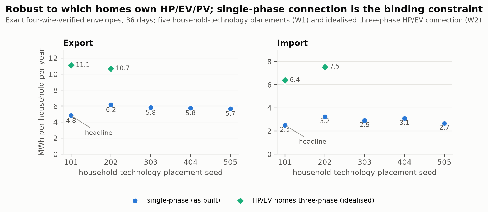
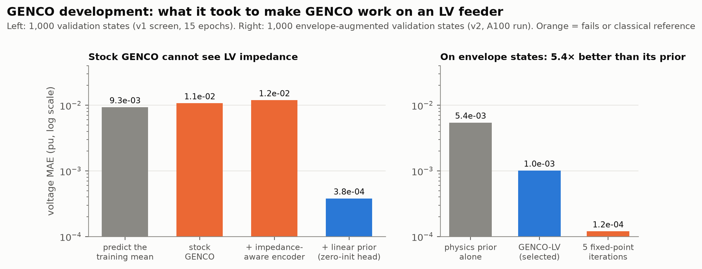
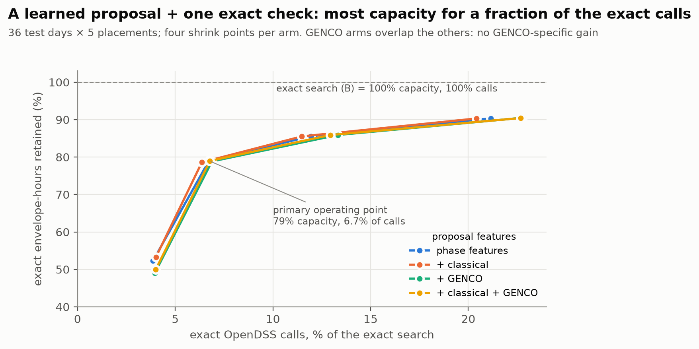
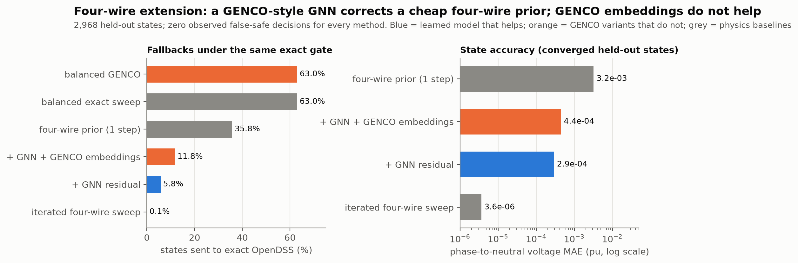

# Four-wire-verified dynamic operating envelopes with GENCO: where a grid foundation model helps on LV networks, and where it does not

*GridFM GENCO Challenge 2026. Team EVERGi, Vrije Universiteit Brussel. Code, protocols and every result: [repository link]. Artifacts: [dataset link].*

---

## TL;DR

- **The problem.** Low-voltage (LV) feeders must host EVs, heat pumps and rooftop PV without immediate reinforcement. A **dynamic operating envelope** (DOE) gives every household a time-varying import/export limit instead of a fixed connection limit.
- **The setting.** We compute DOEs on the four-wire **ENWL1** benchmark feeder (UK, 800 kVA, 200 single-phase customers), populated with **real Fluvius 2024 smart-meter households**. Every issued envelope is checked by an exact four-wire OpenDSS model.
- **The impact.** Dynamic envelopes free **4.8 MWh of export and 2.5 MWh of import** envelope-hours per household per year. A static year-round limit frees **none**, and a balanced (three-phase-averaged) model would issue envelopes that are badly unsafe.
- **What we did with GENCO:**
  1. diagnosed why stock GENCO fails on LV and fixed it;
  2. embedded it in the verified workflow;
  3. extended a GENCO-style model to an explicit **four-wire** (phase + neutral) graph, which cuts exact OpenDSS fallbacks from 35.8% to **5.8%** relative to a one-step four-wire prior;
  4. benchmarked every GENCO role against strong classical methods.
- **The honest result.** GENCO-style learning helps when it corrects a cheap four-wire physics prior. **Pretrained balanced-GENCO representations add no measurable value here**, and a specialised four-wire sweep remains the accuracy leader. We think that is the useful lesson for deploying grid foundation models at LV.

---

## How this entry maps to the judging criteria

| Criterion | Where to look |
|---|---|
| **Originality and impact** | §1: DOEs on a four-wire LV feeder with real Flemish households; capacity a static limit cannot release; balanced models shown to be unsafe. §8: the path from LV envelopes to TSO–DSO coordination with one model across voltage levels |
| **Technical quality** | §2 and §5: exact four-wire verification, pre-registered evaluation, frozen protocols, 72 tests, byte-for-byte reproduction |
| **Exploration of GENCO** | §3–§4: three LV failure modes found and fixed, two tooling bugs, a four-wire GENCO-style extension, and GENCO in four roles benchmarked against classical baselines |
| **Communication** | One-pager, figures and slides; claims stated with their limits (§6) |
| **Open science** | §7: protocols committed before results, every deviation disclosed, run manifests with hashes, `reproduce_check.py` |

---

## 1. Why dynamic envelopes, and why four-wire matters (originality and impact)

DSOs in Belgium and elsewhere are moving to flexible connections. Instead of a fixed limit, a household receives an envelope per interval: "you may export up to *E* kW and import up to *I* kW", valid under forecast uncertainty.

Computing an envelope is a search over power flows, and on LV feeders those power flows must be **four-wire**:
- customers sit on single phases;
- the neutral carries return current;
- phase voltages and loadings diverge strongly from a balanced average.


- **Dynamic, exact four-wire-verified envelopes:** 4.81 MWh export (95% interval 4.35–5.30) and 2.50 MWh import (2.11–2.87) envelope-hours per household per year, over 36 held-out days of 2024.
- **Static limit:** no positive uniform year-round optional allowance passes across the sampled intervals.
- **Balanced model:** its envelopes are 2–3× larger, and four-wire feasible in only 2% (export) and 24% (import) of draws on a summer day. That is exactly the error a balanced foundation model inherits.



- **Placement.** Across five placements of which homes own heat pumps, EVs and PV, capacity ranges from 4.8–6.2 MWh (export) and 2.5–3.2 MWh (import). Our headline placement is the most conservative.
- **Connection.** If HP/EV homes were connected three-phase (an idealised sensitivity), capacity would rise 2–2.5×. **Single-phase connection is the binding constraint.**

## 2. The verified workflow (technical quality)

```
Fluvius profiles → 200 forecast scenarios per interval → proposal → exact four-wire OpenDSS check → envelope
                                                          (exact search | GENCO-screened | learned)
```

- An envelope is issued only if the exact four-wire model finds it feasible in **≥ 98% of the 200 design scenarios**. This is a finite-sample acceptance rule for ε = β = 0.05.
- We call this **four-wire-verified**, not certified:
  - on fresh scenarios, non-zero envelopes reach 97.4% mean four-wire feasibility;
  - but only 47% pass a one-sided 95% lower-bound test, because 200 verification draws are too few to prove 95%.
- The core evaluation was **pre-registered**: the exact search (B) against the GENCO-screened search (C), and the days, seeds and limits.

## 3. GENCO development: making it work on LV (exploration of GENCO)



Transferring GENCO (graphkit `GNS_heterogeneous`) to a 398-bus LV feeder failed: the stock model did worse than predicting the training mean. We traced three causes and fixed each.

1. **Impedance blindness.**
   - *Cause:* the edge encoder is Linear → LeakyReLU → Linear → **LayerNorm**. With LV admittances of order 1e4 the biases are negligible, so the encoder is positively homogeneous and LayerNorm cancels |Y|. The model cannot tell a long cable from a short one.
   - *Fix:* asinh-scaled admittance features.
2. **Physics-loss collapse** at LV numerical scales.
   - *Fix:* a linear power-flow prior (the first Z-bus fixed-point iterate) with a **zero-initialised, scaled correction head**, so training starts exactly at the prior.
3. **Ill-conditioned flows.** Branch flows from voltage differences turn a 1e-4 pu voltage error into an O(100%) flow error on short cables.
   - *Fix:* Kirchhoff-current-law flows.

**Result.** Voltage MAE 1.0e-3 pu on envelope-augmented states, 5.4× better than the prior alone. Five classical fixed-point iterations are still more accurate (1.2e-4), and we say so.

**Tooling bugs found along the way:**
- graphkit's best-model export stored a metric tensor, so it silently exported epoch-0 weights;
- datakit pinned the slack voltage at 1.5 pu.

## 4. GENCO in the workflow, and an honest benchmark (exploration of GENCO)

We tested GENCO in four roles, each against the strongest classical alternative we could build.

| GENCO role | Result | Classical comparison |
|---|---|---|
| **Screen in the exact search** (C, plus a final exact gate, C+) | C+ matches the exact search on 100% of 1,728 intervals with 6% fewer exact calls. C alone had one material false acceptance. | Exact balanced sweep and fixed-point screens are equally good. |
| **Learned four-wire screening head** (Option 2) | A learned head clears 21–26% of states without OpenDSS (against 2%). | Phase-composition features alone do as well; the GENCO-feature arm is worse. |
| **Envelope proposals** + one exact check | 79% of exact capacity with **6.7% of the exact OpenDSS calls**; 90% with 21% (an exact-call reduction, not a measured speed-up). | The GENCO arms are no better: −0.06 points, CI [−0.46, +0.32]. |
| **Four-wire extension** (below) | A GENCO-style GNN corrects a one-step four-wire prior. | The iterated four-wire sweep is about 80× more accurate. |



### The four-wire extension: removing the balanced bottleneck

The recurring failure was structural: GENCO is a **balanced** model, and on this feeder what binds is single-phase, four-wire physics. We therefore built a GENCO-style encode–process–decode GNN on the explicit four-wire graph:
- 397 buses, each with conductors a, b, c and n;
- full 4×4 line impedances, no Kron reduction;
- an edge-conditioned TransformerConv processor;
- a zero-initialised residual on top of a **one-step four-wire sweep prior**.

It was evaluated under a frozen protocol on 2,968 held-out states, with the same exact gate for every method.



- **Against the one-step four-wire prior:** voltage error **−91%**, OpenDSS fallbacks **35.8% → 5.8%**, near-limit violation-classification balanced accuracy 0.926 → 0.992. The exact four-wire gate preserved the frozen acceptance rule and produced **zero observed false-safe decisions** on the held-out evaluation.
- **GENCO-specific ablation:** conditioning the same model on node-aligned embeddings from our trained balanced GENCO made it **worse**: +6.0 points of fallbacks, CI [+5.3, +6.7].
- **Classical reference:** the iterated four-wire sweep reaches 3.6e-6 pu error and 0.1% fallback. The learned model's lower end-to-end time (2.1 vs 5.5 ms per state) compares an A100 model with an unoptimised CPU sweep, so we do not claim a speed advantage.

**What this shows.** A learned residual over a cheap four-wire prior works. The one-step prior is itself phase-aware, so this does not isolate phase representation as the cause, but the balanced baselines (63% fallback) indicate that phase information is necessary. Pretrained balanced representations did not transfer.

## 5. Rigour (technical quality)

- **Frozen before results.** Every study after the pre-registered core (C+, placement and connection sensitivities, spatial envelopes, Option 2, envelope proposals, the four-wire extension) had its protocol committed before any result was produced.
- **Deviations** are disclosed as numbered amendments.
- **Incidents found by our own checks, fixed and disclosed:**
  - a wrong voltage base;
  - an OpenDSS engine-poisoning bug (a divergent first solve broke the engine; found because the fit's iteration count looked wrong);
  - stale cluster file caches serving old files;
  - an invalid fit, quarantined with hashes.
- **Checks:** 72 automated tests, label-integrity checks with physics (KCL) validation, and hash-verified inputs for every fit and gate run.

## 6. What we claim, and what we do not (communication)

**We claim:**
- dynamic four-wire-verified envelopes release capacity that a static limit cannot;
- balanced models are unsafe on this feeder;
- GENCO can be adapted to LV and guarded by an exact four-wire gate;
- a GENCO-style four-wire GNN corrects a cheap four-wire prior.

**We do not claim:**
- unconditional safety;
- a GENCO advantage over specialised classical solvers;
- a wall-clock speed-up;
- generalisation beyond this one benchmark feeder.

Test dates were also used during development, so all post-hoc results are exploratory. The full list is in [`docs/claims.md`](claims.md).

## 7. Open science

- **Code and records.** Code, protocols, amendments, the experiment log and every result file are in the repository. `scripts/reproduce_check.py` regenerates every headline number byte for byte from recorded inputs.
- **Run manifests** record commits, Slurm job IDs and SHA-256 hashes of every artifact.
- **Artifacts.** Model checkpoints and four-wire labels: [dataset link, pending]. Raw Fluvius data is not redistributed.

## 8. Where this goes: one model across LV, MV and HV for TSO–DSO coordination (impact)

Flexible connections are not an LV problem alone. The sum of the household envelopes on a feeder is the flexibility range that the DSO can offer upward at the MV/LV transformer, and the sum over feeders is what the TSO sees at the transmission bus. Today each level runs its own tool with its own physics, and the ranges are passed by hand or not at all. A grid foundation model that reads every level as one graph is the natural candidate to close that loop, and this entry already contains the first two tiers of it:

| Tier | What this entry has | Role in coordination |
|---|---|---|
| **LV** (four-wire) | per-household envelopes on ENWL1, exactly verified | the envelopes sum to a transformer-level P/Q flexibility range |
| **MV** (balanced) | GENCO-OPF on case33bw with the substation as root (exploratory, in progress) | hosts the transformer ranges as dispatchable units; passes the aggregate up |
| **HV** (positive-sequence, meshed) | GENCO's native pretraining domain | consumes the aggregate as a flexibility envelope at the transmission bus |

The interface between tiers is a boundary equivalent at the root. We already fit a Thevenin equivalent at the LV root from training labels, which is the same device a learned model would need to carry between levels.

**What our results say a single cross-level model must solve.** The LV failures in §3 are not LV quirks; they are what a model sees when its training domain is three orders of magnitude away in impedance and power:
1. **Scale.** Stock GENCO's edge encoder normalised away admittance magnitude. Across LV to HV, |Y| spans several orders of magnitude, so magnitude-preserving edge features (our asinh fix) are a requirement, not an option.
2. **Representation.** LV needs phase and neutral states; HV is positive-sequence. Our four-wire extension showed that balanced embeddings do not transfer downward. A cross-level model needs level-typed nodes and edges with a shared processor, not one state vector forced on every level.
3. **Verification.** Every tier keeps an exact gate of its own physics. The model proposes; the gate decides. That is the only way the finite-sample safety rule survives aggregation.

**What we would test next, with no new data needed first.** Aggregate the ENWL1 envelopes to a transformer P/Q range per interval, feed that range as the unit bounds of the case33bw GENCO-OPF stage, and measure the hosted flexibility and safety of the two-tier chain against a two-tier IPOPT reference. A multi-network, multi-level pretraining run is the step after, and the one that would turn this outlook into a claim.

We do not claim any of this works. We claim the LV result tells you what it would take.
